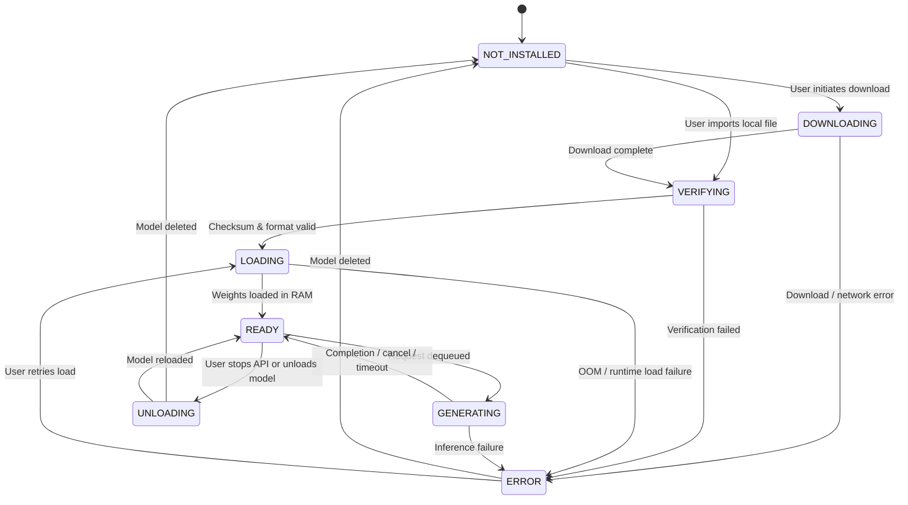

# 02 — UOAI Provider (`com.uoai.provider`) Functional Requirements

| Control Field | Detail |
| :--- | :--- |
| **Document ID** | `UOAI-BRD-02` |
| **Target Application** | UOAI Provider (`com.uoai.provider`) |
| **API Version** | `v1` (`http://127.0.0.1:8765/v1`) |
| **Owner** | UOAI Project Team |

---

## 1. Functional Requirements Matrix

| ID | Requirement Area | Priority |
| :--- | :--- | :--- |
| `FR-PRV-001` | Local Model Storage, User-Initiated Acquisition & Deletion | Must Have |
| `FR-PRV-002` | Supported Model Families, Hardware Execution & `"auto"` Routing | Must Have |
| `FR-PRV-003` | Model Lifecycle State Machine & Health Reporting | Must Have |
| `FR-PRV-004` | Persistent Non-Sticky Foreground Service (`ProviderService`) | Must Have |
| `FR-PRV-005` | OS-Verified Client Registration & Certificate Pinning | Must Have |
| `FR-PRV-006` | Per-Client Access Governance (Clients Tab) | Must Have |
| `FR-PRV-007` | Shared Inference Execution, Queuing, Size & Token Caps | Must Have |
| `FR-PRV-008` | Streaming (SSE) & Client-Isolated Request Cancellation | Must Have |
| `FR-PRV-009` | Client-Owned & Provider-Owned Tool Calling | Must Have |
| `FR-PRV-010` | Metadata-Only Audit Trail & Full Data Wipe Controls | Must Have |

---

## 2. Detailed Functional Specifications

### `FR-PRV-001` — Local Model Storage, Acquisition & Deletion
- **Description:** UOAI Provider must manage AI model files strictly inside the app's private internal storage sandbox.
- **Supported Model Formats:**
  - LiteRT-LM (`.litertlm`)
  - MediaPipe (`.task`)
  - GGUF
- **Acquisition Flows:**
  1. Direct user-initiated downloads from public open-source repositories (e.g., Hugging Face). No background or automatic model downloads without explicit user action.
  2. Manual local import from device storage selected by the user.
- **Deletion:** Users must be able to delete downloaded or imported model bundles at any time from the **Models** screen to reclaim device storage.

---

### `FR-PRV-002` — Supported Model Families, Hardware Execution & `"auto"` Routing
- **Description:** The inference engine must execute open-weight LLMs entirely on physical device hardware (**CPU**, **GPU**, or **NPU**).
- **Supported Model Families:**
  - **Gemma 3:** `.task` and `.litertlm` variants.
  - **Gemma 4 Tiers:** `E2B`, `E4B`, `12B`, `26B-A4B`, and `31B` (for example, `gemma-4-e2b` / `gemma-4-E2B-it`, `litertlm`, quantization `e2b`, ~`2,588,100,000` bytes, `32,768` context window).
- **Model Selection & Routing:**
  - Support `"model": "auto"` (recommended default) to route automatically to whichever Gemma 3 or Gemma 4 model is currently loaded.
  - Also accept `"default"`, `"gemma-4"`, `"gemma-3"`, or the exact active model `id`.
  - Unknown or unavailable model identifiers must return `HTTP 404` (`model_not_found`).

---

### `FR-PRV-003` — Model Lifecycle State Machine & Health Reporting
- **Description:** UOAI Provider must track and expose the exact operational state of the local model via `GET /v1/health` (unauthenticated).
- **Required States:**
  - `NOT_INSTALLED`
  - `DOWNLOADING`
  - `VERIFYING`
  - `LOADING`
  - `READY`
  - `GENERATING`
  - `UNLOADING`
  - `ERROR`
- **Health Payload Behavior:**
  - When ready/operational, `status` is `"ok"` and `model_loaded` is `true` (or reflects loaded state).
  - When unavailable, `status` is `"degraded"`, `model_loaded` is `false`, and an optional `model_error` field explains the failure reason.

---

### `FR-PRV-004` — Persistent Non-Sticky Foreground Service (`ProviderService`)
- **Description:** Because Android apps cannot directly share process memory, UOAI Provider runs an Android Foreground Service (`ProviderService`) to keep the single loaded model in RAM and the embedded Ktor CIO HTTP/SSE server active while approved clients send requests.
- **Notification Requirement:**
  - Requires `FOREGROUND_SERVICE` & `FOREGROUND_SERVICE_SPECIAL_USE`, plus `POST_NOTIFICATIONS` (runtime on Android 13+ / API 33+).
  - Must display a permanent ongoing notification showing server state, the active loaded model, and a one-tap **"Stop API"** action button.
- **Intentional Non-Sticky Lifecycle Rule:**
  - `ProviderService` is intentionally **non-sticky**. If the user taps "Stop API" or Android OS reclaims background processes under memory pressure, the service stops cleanly rather than aggressively restarting in the background. Client apps handle connection refusal gracefully by offering a one-tap **Open Provider** recovery action.

---

### `FR-PRV-005` — OS-Verified Client Registration & Certificate Pinning
- **Description:** Client applications must obtain user consent and an authenticated Bearer token before accessing inference endpoints.
- **Registration Intent Contract:**
  - Action: `com.uoai.provider.action.REGISTER` targeting package `com.uoai.provider`.
  - Clients must launch the Intent via `startActivityForResult` / `ActivityResultContracts.StartActivityForResult()` **without** `FLAG_ACTIVITY_NEW_TASK`, preserving the Android OS caller identity.
- **OS Verification & Pinning Rules:**
  - Provider inspects the OS-supplied `callingPackage` and the caller APK's **single-signer** SHA-256 signing certificate fingerprint.
  - Multi-signer APKs must be rejected.
  - On first approval, the provider pins the client's `packageName` to its SHA-256 certificate fingerprint and stores the client record plus SHA-256 hash of the issued token in Room (`client_credentials` table).
  - If an already `APPROVED` client re-registers with a matching certificate, the provider silently rotates and returns a fresh token.
- **Return Payloads:**
  - **Approved (`Activity.RESULT_OK`):** Extras `token` (`"uoai_..."`) and `client_id`.
  - **Denied / Aborted (`Activity.RESULT_CANCELED`):** Extras `error_code` and `error`. Valid `error_code` values: `no_caller`, `identity`, `certificate_mismatch`, `disabled`, `rejected`, `cancelled`.

---

### `FR-PRV-006` — Per-Client Access Governance (Clients Tab)
- **Description:** Users must retain full control over every registered client application from the provider's **Clients** tab.
- **Stored Client Record Attributes:**
  - Package name (e.g., `com.uoai.chat`, `com.uoai.keyboard`)
  - Friendly application label
  - Single-signer APK SHA-256 certificate fingerprint
  - SHA-256 hash of the active access token (in Room `client_credentials` table; plaintext token is never persisted by the provider after handoff)
- **User Controls:**
  - Grant or toggle per-client permissions: `chat`, `streaming`, and `tool_calling`.
  - Configure per-client maximum token cap (`client_cap`).
  - Immediately revoke any approved client application, invalidating its Bearer token (`HTTP 401 invalid_token` on subsequent requests).

---

### `FR-PRV-007` — Shared Inference Execution, Queuing, Size & Token Caps
- **Description:** Because a single model instance is shared across all installed client apps, UOAI Provider must strictly enforce concurrency, payload, token, and timeout boundaries.
- **Operational Limits:**
  - **Concurrent Active Generations:** `1` active generation shared across all client apps.
  - **Request Queue Depth:** Maximum `16` requests globally and `4` requests per client. Exceeding either limit immediately returns `HTTP 429` (`queue_full`).
  - **Max Request Payload Size:** `2,097,152` bytes (2 MiB). Requests exceeding this limit return `HTTP 413` (`request_too_large`).
  - **Context & Output Token Cap:** Up to `32,768` tokens. Effective generation cap is calculated as:
    `effective = min(request.max_tokens, client_cap, 32768)` (default `max_tokens` = `2,048` when omitted).
  - **Generation Timeout:** `300,000` ms (`300` seconds). Exceeding the timeout returns `HTTP 504` (`request_timeout`) or emits a mid-stream error event.
  - **Sampling Bounds:** `temperature` (`0.0 .. 2.0`), `top_p` (clamped to `0.05 .. 1.0`), `top_k` (clamped to `1 .. 128`).

---

### `FR-PRV-008` — Streaming (SSE) & Client-Isolated Request Cancellation
- **Description:** Clients must be able to receive tokens incrementally and cancel long-running generations cleanly.
- **Request Correlation:** Every `200 OK` response to `POST /v1/chat/completions` must include header `X-Request-Id: chatcmpl-<uuid>`.
- **Streaming Mode (`stream: true`):**
  - Requires `streaming` permission enabled for the client and `Accept: text/event-stream`.
  - Emits OpenAI-compatible `data: {...}` `chat.completion.chunk` JSON frames followed by `data: [DONE]`.
  - On cancellation, emits a chunk with `finish_reason: "cancelled"` (or `HTTP 409 request_cancelled`).
- **Cancellation Endpoint (`POST /v1/cancel`):**
  - Accepts `{"request_id": "chatcmpl-..."}` and returns `{"request_id": "...", "cancelled": true|false}`.
  - **Strict Client Isolation:** A client may only cancel requests it owns. Attempting to cancel another client app's `request_id` or an unknown ID must return `"cancelled": false`.

---

### `FR-PRV-009` — Client-Owned & Provider-Owned Tool Calling
- **Description:** UOAI Provider must support structured function calling in non-streaming mode when the client holds the `toolCalling` permission.
- **Constraints:** Both `tools` and `use_provider_tools` require `stream: false` and `toolCalling` permission enabled for the requesting client.
- **Client-Owned Tools (`tools`):**
  - Accepts OpenAI-style function schemas (`{"type":"function","function":{"name","description","parameters":{...}}}`).
  - Returns `finish_reason: "tool_calls"` and `message.tool_calls` (`id`, `function.name`, JSON-string `function.arguments`) so the client app can execute the function locally and submit a follow-up turn.
- **Provider-Owned Safe Tools (`use_provider_tools: true`):**
  - Injects enabled built-in safe provider tools (`calculator`, `device_info`), executes them internally, and returns the final assistant completion directly.

---

### `FR-PRV-010` — Metadata-Only Audit Trail & Full Data Wipe Controls
- **Description:** UOAI Provider may maintain an optional local audit log for diagnostics and usage visibility without compromising prompt privacy.
- **Permitted Audit Fields (Metadata Only):**
  - Timestamps
  - Client package name
  - Token counts
  - Execution latency
- **Prohibited Audit Fields:** Prompt text, system instructions, tool payloads, and generated completions must **never** be logged or saved in audit records or the database.
- **Full Data Wipe:** Clearing app storage (`Settings → Apps → UOAI Provider → Storage → Clear Storage`) or uninstalling the app must permanently purge all private storage, model files, Room credentials, Keystore secrets, and audit logs.
