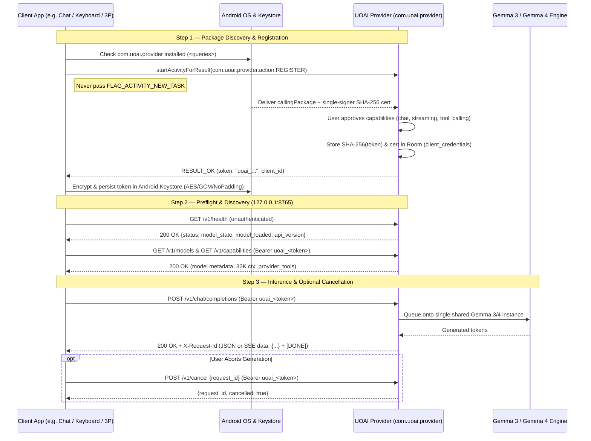

# 03 — Technical Architecture & API Specification

| Control Field | Detail |
| :--- | :--- |
| **Document ID** | `UOAI-BRD-03` |
| **Target Service** | UOAI Provider (`com.uoai.provider`) |
| **Server Stack** | Embedded Ktor CIO HTTP/SSE Server |
| **Endpoint Base URL** | `http://127.0.0.1:8765/v1` |

---

## 1. System Architecture & IPC Trust Flow

Because Android isolates application processes, UOAI Provider pairs **Android OS Caller Verification** (during one-time registration) with **Localhost Loopback HTTP/SSE** (for ongoing inference).



---

## 2. Network & Security Architecture

### 2.1 Loopback-Only Server Binding
- The embedded **Ktor CIO** server binds strictly to `127.0.0.1:8765` (loopback interface).
- It **never** binds to `0.0.0.0` or any external network interface.
- It is unreachable from the internet, local Wi-Fi, or cellular networks; only requests originating inside the local Android OS kernel on the same physical device can reach it.

### 2.2 Client Network Security Configuration
Client apps must **not** enable global `android:usesCleartextTraffic="true"`. Cleartext HTTP must be restricted strictly to `127.0.0.1` and `localhost` via `uoai_network_security_config.xml`:

```xml
<?xml version="1.0" encoding="utf-8"?>
<network-security-config>
    <domain-config cleartextTrafficPermitted="true">
        <domain includeSubdomains="false">127.0.0.1</domain>
        <domain includeSubdomains="false">localhost</domain>
    </domain-config>
</network-security-config>
```

### 2.3 Cryptographic Token Lifecycle
- **Issuance:** Provider generates a random `uoai_<token>` upon OS-verified approval.
- **Provider Storage:** Provider stores only the **SHA-256 hash** of the token alongside the client package name, friendly label, and single-signer APK SHA-256 certificate fingerprint in Room (`client_credentials` table).
- **Client Storage:** Client SDK encrypts the token in the hardware-backed **Android Keystore** (`AES/GCM/NoPadding` / `EncryptedSharedPreferences`).
- **Transport Auth:** Every `/v1/*` request (except `/v1/health`) must carry `Authorization: Bearer uoai_<token>`.

---

## 3. OpenAI-Compatible Loopback API Specification (`http://127.0.0.1:8765/v1`)

### 3.1 `GET /v1/health` (Unauthenticated)
Checks whether the Ktor CIO server is reachable and reports the current model lifecycle state.

```json
{
  "status": "ok",
  "model_state": "READY",
  "model_loaded": true,
  "api_version": "v1"
}
```

- **`model_state` enum:** `NOT_INSTALLED`, `DOWNLOADING`, `VERIFYING`, `LOADING`, `READY`, `GENERATING`, `UNLOADING`, `ERROR`.
- **Degraded behavior:** When unavailable, `status` is `"degraded"`, `model_loaded` is `false`, and an optional `model_error` string explains the reason.

---

### 3.2 `GET /v1/models` (Authenticated)
Returns metadata for the loaded/available model(s).

```json
{
  "object": "list",
  "data": [
    {
      "id": "gemma-4-e2b",
      "object": "model",
      "owned_by": "universal-offline-ai",
      "name": "gemma-4-E2B-it",
      "format": "litertlm",
      "quantization": "e2b",
      "size_bytes": 2588100000,
      "ready": true,
      "context_window": 32768
    }
  ]
}
```

---

### 3.3 `GET /v1/capabilities` (Authenticated)
Clients should query this endpoint on connect to inspect dynamic token limits, concurrency, and enabled provider tools instead of hardcoding values.

```json
{
  "features": ["chat", "streaming", "cancellation", "tool-calling"],
  "max_request_bytes": 2097152,
  "max_tokens_limit": 32768,
  "concurrent_generations": 1,
  "embeddings": false,
  "provider_tools": ["calculator", "device_info"],
  "context_window_tokens": 32768,
  "default_max_tokens": 2048
}
```

---

### 3.4 `POST /v1/chat/completions` (Authenticated)

#### Request Parameters
| Field | Type | Required | Constraints & Notes |
| :--- | :--- | :--- | :--- |
| `model` | `string` | No | `"auto"` (recommended), active model `id`, `"default"`, `"gemma-4"`, or `"gemma-3"`. Unknown models return `404`. |
| `messages` | `array` | **Yes** | Array of objects with `role` (`"system" \| "user" \| "assistant" \| "tool"`), `content`, and optional `tool_call_id`, `name`. Must contain at least one `"user"` or `"tool"` message. |
| `temperature` | `float` | No | `0.0 .. 2.0` (provider default if omitted). |
| `max_tokens` | `int` | No | `1 .. 32768` (`effective = min(request.max_tokens, client_cap, 32768)`). |
| `top_p` | `float` | No | Nucleus sampling (clamped to `0.05 .. 1.0`). |
| `top_k` | `int` | No | Top-k sampling (clamped to `1 .. 128`). |
| `stream` | `boolean` | No | `false` (JSON) or `true` (SSE). Requires `streaming` permission. |
| `tools` | `array` | No | Client-owned function schemas (`stream` must be `false`). Requires `toolCalling` permission. |
| `use_provider_tools` | `boolean` | No | Injects provider-owned tools (`stream` must be `false`). Requires `toolCalling` permission. |

Every `200 OK` response includes HTTP header `X-Request-Id: chatcmpl-<uuid>` for cancellation tracking.

#### Non-Streaming Response (`stream: false`)
```json
{
  "id": "chatcmpl-d425bd9b-a9a2-44f1-9cb1-53fb58590ddb",
  "object": "chat.completion",
  "created": 1795105164,
  "model": "gemma-4-e2b",
  "choices": [
    {
      "index": 0,
      "message": {
        "role": "assistant",
        "content": "Paris"
      },
      "finish_reason": "stop"
    }
  ]
}
```

#### Streaming Response (`stream: true`, `Accept: text/event-stream`)
```text
data: {"id":"chatcmpl-...","object":"chat.completion.chunk","created":1795105166,"model":"gemma-4-e2b","choices":[{"index":0,"delta":{"role":"assistant"}}]}

data: {"id":"chatcmpl-...","object":"chat.completion.chunk","created":1795105166,"model":"gemma-4-e2b","choices":[{"index":0,"delta":{"content":"Hello"}}]}

data: {"id":"chatcmpl-...","object":"chat.completion.chunk","created":1795105166,"model":"gemma-4-e2b","choices":[{"index":0,"delta":{},"finish_reason":"stop"}]}

data: [DONE]
```

**SSE Client Parsing Rules:**
1. Skip blank lines and any line not starting with `data:`.
2. Trim the `data:` prefix.
3. Stop reading when the payload equals `[DONE]`.
4. Abort immediately if a JSON `"error"` key appears in an event payload.
5. Append `choices[0].delta.content` to the output buffer.
6. Handle `finish_reason == "cancelled"` as a clean request cancellation.

---

### 3.5 `POST /v1/cancel` (Authenticated)
Cancels an active or queued generation owned by the calling client.

```json
// Request
{
  "request_id": "chatcmpl-8b26e9d9-1b6b-41e9-aa85-fc8bdb7b163f"
}

// Response
{
  "request_id": "chatcmpl-8b26e9d9-1b6b-41e9-aa85-fc8bdb7b163f",
  "cancelled": true
}
```

- **Isolation Rule:** Cancelling another app's request ID or an unknown request ID returns `"cancelled": false`.

---

## 4. Tool Calling Protocol Specification

Both tool calling modes require the client's `toolCalling` permission to be enabled in UOAI Provider and `stream: false`.

### 4.1 Client-Owned Tools (`tools`)
1. Client sends OpenAI-style function schemas:
   `{"type":"function","function":{"name":"...","description":"...","parameters":{...}}}`.
2. If the model invokes a tool, the provider returns `finish_reason: "tool_calls"` and `message.tool_calls` (`id`, `function.name`, and JSON-string `function.arguments`).
3. Client executes the function locally and sends a follow-up `/v1/chat/completions` turn containing:
   - Original `user` message
   - `assistant` message with `"content": "<tool_call>{\"name\":\"...\",\"arguments\":{...}}</tool_call>"`
   - `tool` message with `{"role":"tool","tool_call_id":"...","name":"...","content":"<result>"}`

### 4.2 Provider-Owned Safe Tools (`use_provider_tools: true`)
When `use_provider_tools: true` is set, the provider automatically injects and executes enabled built-in safe tools (`calculator`, `device_info`) and returns the final assistant answer directly.

---

## 5. Non-Functional Requirements (NFRs)

| Category | Requirement | Target / Constraint |
| :--- | :--- | :--- |
| **Payload Size** | Max request body size | `2,097,152` bytes (2 MiB) |
| **Context Window** | Prompt + output token budget | Up to `32,768` tokens (`prompt_tokens + max_tokens <= context_window_tokens`) |
| **Timeout** | Max single generation duration | `300,000` ms (`300` seconds) |
| **Concurrency** | Shared active generation slots | `1` concurrent generation across all apps |
| **Queue Capacity** | Bounded request buffering | `16` global queued requests / `4` per client |
| **Network Isolation** | Socket exposure | `127.0.0.1:8765` only; zero external network bindings |
| **Lifecycle Resilience** | Service reclamation handling | Non-sticky `ProviderService`; clients must recover via `ON_RESUME` + "Open Provider" |
| **Minimum OS / SDK** | Android compatibility | Client SDK `minSdk 26` (Android 8.0+); `<queries>` manifest support for API 30+; `POST_NOTIFICATIONS` on API 33+ |

---

## 6. Error Envelope & Recovery Playbook

All non-2xx HTTP responses conform to:
```json
{
  "error": {
    "message": "...",
    "type": "...",
    "code": "..."
  }
}
```

| HTTP / Failure | `error.code` | Kotlin SDK Exception | Required Client UI Recovery |
| :--- | :--- | :--- | :--- |
| Package missing | — | `ProviderNotInstalledException` | Show "Install Universal Offline AI Provider (`com.uoai.provider`)". |
| Socket refused | — | `ProviderNotRunningException` | Prompt user to tap **Open Provider** and start the API server. |
| `400` | `invalid_json`, `missing_messages`, `invalid_role`, `missing_user_message`, `invalid_temperature`, `invalid_max_tokens`, `invalid_request` | `ApiException` | Fix request payload (`temperature` `0..2`, `max_tokens` `1..32768`, ≥1 `user` or `tool` message). |
| `401` | `missing_token`, `invalid_token` | `NotRegisteredException` | Clear saved token (`clearCredentials()`) and relaunch registration Intent. |
| `403` | `permission_denied` | `PermissionDeniedException` | Prompt user to enable `chat`, `streaming`, or `tool_calling` in **Provider → Clients**. |
| `404` | `model_not_found` | `ApiException` | Pass `"model": "auto"` or query `GET /v1/models`. |
| `409` | `request_cancelled` | `RequestCancelledException` | Handle as clean user abort. |
| `413` | `request_too_large` | `ApiException` | Trim message history below 2 MiB (`2,097,152` bytes). |
| `429` | `queue_full` | `ApiException` | Queue limit hit (`16` global / `4` per client); back off briefly and retry. |
| `500` | `internal_error`, `inference_failed` | `ApiException` | Display error notice and offer retry. |
| `503` | `model_not_ready` | `ModelNotReadyException` | Prompt user to **Open Provider** and load a model. |
| `504` | `request_timeout` | `ApiException` | Exceeded `300` s; reduce prompt size or `max_tokens`. |
